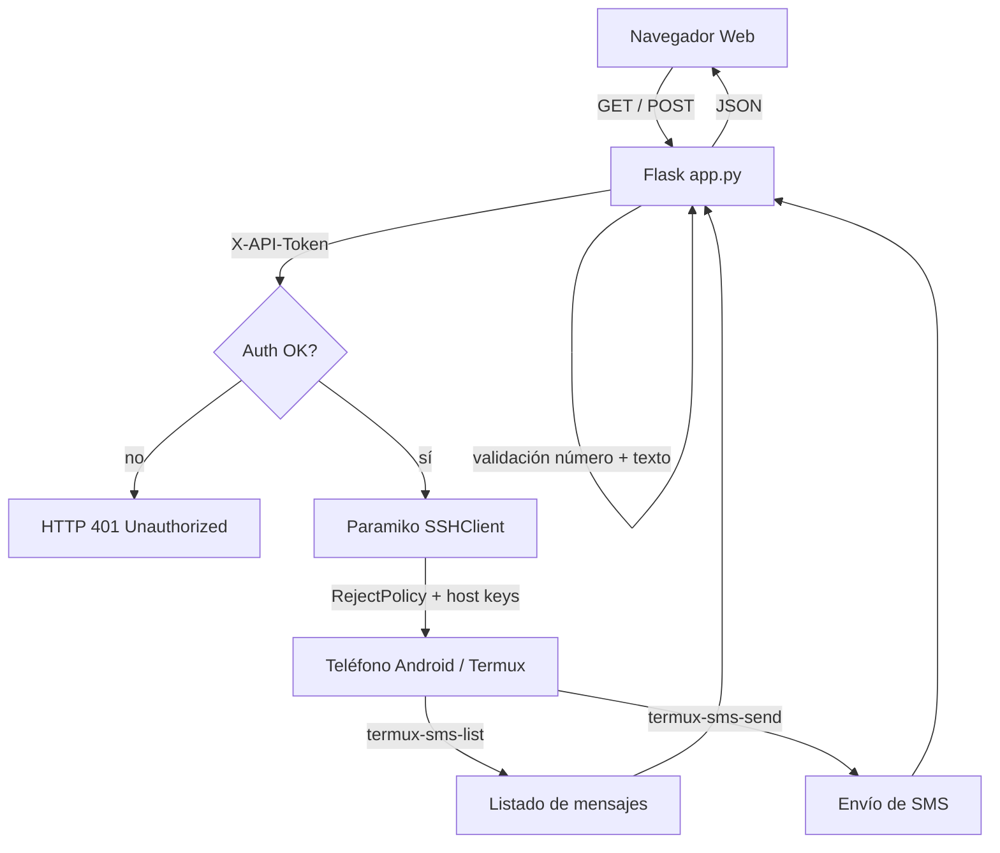

# rtu-web

Interfaz web para enviar y recibir SMS de forma remota a través de un teléfono Android con Termux por SSH. Usa Flask para la interfaz web y Paramiko para la conectividad SSH.

[](LICENSE)
[](https://python.org)
[](https://github.com/bi0punk/rtu-web/actions/workflows/ci.yml)

## Contenido

- [Características](#características)
- [Arquitectura](#arquitectura)
- [Stack](#stack)
- [Estructura del repositorio](#estructura-del-repositorio)
- [Instalación](#instalación)
- [Uso](#uso)
- [Configuración](#configuración)
- [API](#api)
- [Tests / CI](#tests--ci)
- [Seguridad](#seguridad)
- [Roadmap](#roadmap)
- [Licencia](#licencia)

## Características

- Listado de mensajes SMS via `termux-sms-list`
- Envío de SMS con validación de número y sanitización de texto
- Conexión SSH a Android con Termux
- Autenticación por token via cabecera `X-API-Token`
- Validación de número con regex (`^\+?\d{7,15}$`)
- Protección contra command injection con `shlex.quote()`

## Arquitectura



## Stack

- Python 3.11+
- Flask (interface web + API)
- Paramiko (cliente SSH)
- python-dotenv (configuración por entorno)

## Estructura del repositorio

```
rtu-web/
├── app.py
├── templates/
│   └── index.html
├── tests/
│   └── test_smoke.py
├── .github/workflows/
│   └── ci.yml
├── requirements.txt
├── pyproject.toml
├── .env.example
├── .gitignore
├── LICENSE
└── README.md
```

## Instalación

```bash
git clone https://github.com/bi0punk/rtu-web.git
cd rtu-web
python -m venv .venv && source .venv/bin/activate
pip install -r requirements.txt
```

## Uso

```bash
# Configurar credenciales SSH en .env
cp .env.example .env
# Editar SSH_HOST, SSH_USER, SSH_PASSWORD y API_TOKEN

python app.py
```

Abrir `http://localhost:5000` para acceder a la interfaz SMS. La app arranca en `127.0.0.1:5000` y falla en el arranque si faltan variables de entorno.

## Configuración

Variables de entorno (ver `.env.example`):

| Variable        | Descripción                          |
|-----------------|--------------------------------------|
| `SSH_HOST`      | IP del teléfono Android              |
| `SSH_USER`      | Usuario SSH de Termux                |
| `SSH_PASSWORD`  | Contraseña SSH de Termux             |
| `API_TOKEN`     | Token para autenticar la API         |

## API

| Método | Endpoint      | Descripción                                     |
|--------|---------------|-------------------------------------------------|
| GET    | `/`           | Página web (incluye el API token)               |
| GET    | `/messages`   | Lista SMS via `termux-sms-list`                 |
| POST   | `/send`       | Envía SMS (`number` validado, `text` sanitizado)|

Autenticación obligatoria en `/messages` y `/send` mediante cabecera `X-API-Token`.

## Tests / CI

```bash
pip install pytest ruff
pytest -q
ruff check .
```

GitHub Actions (`.github/workflows/ci.yml`) ejecuta ruff lint + pytest sobre Python 3.11 en cada push y PR, instalando las dependencias de desarrollo con `uv`.

## Seguridad

- **Command injection:** Número validado con regex `^\d{7,15}$`; texto escapado via `shlex.quote()`
- **SSH:** Host key verification usa `RejectPolicy` (rechaza hosts desconocidos)
- **API:** verificación de token en cabecera `X-API-Token`
- Ejecutar detrás de reverse proxy con HTTPS en producción

## Roadmap

- [x] Listado de SMS remoto
- [x] Envío de SMS remoto
- [ ] Soporte para MMS
- [ ] Historial de mensajes enviados
- [ ] Contactos desde la agenda del teléfono
- [ ] WebSockets para notificaciones en tiempo real

## Licencia

MIT